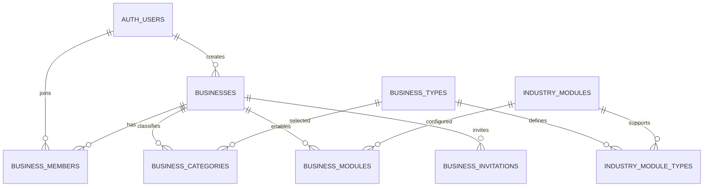

# BizAssist ERP

BizAssist is a single Next.js application backed by one Supabase PostgreSQL project. This initial slice implements email authentication, business onboarding, nine seeded industry types, module configuration, multi-business membership, a data-driven workspace shell, and tenant RLS for the foundation tables.

## Local setup

1. Use Node.js 20 or newer and create a Supabase project.
2. Copy `.env.example` to `.env.local`; set the Supabase project URL and anon key. The anon key is safe for browser use; never add a service-role key to this app.
3. Apply `supabase/migrations/202611260001_universal_industry_onboarding.sql` to the Supabase project (for example with the Supabase CLI: `supabase db push`).
4. In Supabase Auth, enable email/password sign-in and configure the site URL and redirect URL to include `http://localhost:3000/auth/callback`.
5. Run `npm install` and `npm run dev`.

After verification, Supabase returns to `/auth/callback`; the root route sends a user with a business membership to its workspace and a new user to onboarding. A single login may own or join multiple business profiles. The business switcher reads only memberships allowed by RLS.

## Architecture

`businesses.business_type` stores the primary industry. `business_categories` stores the primary and optional additional categories selected during onboarding. `business_modules` stores each business profile's enabled module state; industry-to-module defaults live in `industry_module_types`. Separate business profiles therefore have separate module settings, and future operational tables are expected to carry `business_id` rather than being shared implicitly.

## Routes

- `/login` — sign up and sign in; verification returns through `/auth/callback`.
- `/onboarding` — four-step category, profile and preference flow.
- `/business/[businessId]` — authenticated business workspace, membership switcher, modules and module settings.
- `/auth/callback` — exchanges Supabase verification code for a session.

The workspace only shows business identity and enabled module configuration. It does not invent sales or inventory figures. Product, inventory, sales, purchase and accounting workspaces need their own schemas and server operations before they should display operational data.

## Security and transaction boundaries

- User identity comes from Supabase Auth SSR sessions; server actions re-check `auth.getUser()`.
- `create_business_onboarding` is one database transaction that validates active categories, creates the business, owner membership, selected categories and initial module rows. It is `SECURITY DEFINER`, has a fixed empty `search_path`, requires `auth.uid()`, and is executable only by authenticated users.
- RLS scopes business and child configuration reads through `is_business_member`. Business profile writes require owner membership. Module changes go through `set_business_module`, which checks owner/manager role in the database.
- Future business-owned tables must enable RLS and use `is_business_member(business_id)` for read access and role checks for mutations. Business module authorization must also be checked in server operations/RPCs, not only in navigation.
- The browser never receives a service-role credential. The public Supabase anon key is used with RLS.

## Planned implementation

1. **Foundation (current):** auth callbacks, onboarding, multi-business profiles, industry/module schema and RLS.
2. **Inventory:** categories, products, warehouses and append-only stock movements.
3. **Sales and purchasing:** customers, suppliers, sales/purchases, atomic stock updates and invoices.
4. **Money:** payment allocations, ledger entries, expenses and reversals.
5. **Operations:** POS, returns, delivery, industry extensions and integrations with real providers.
6. **Analytics and people:** query-backed dashboards, reports, employees, notifications and Bengali translations.
7. **Hardening:** integration coverage for authentication and RLS boundaries, deployment and security review.

The pharmacy module flag is a configuration point only; it does not claim to implement regulatory compliance. The database and workspace are intended to be expanded before enabling those workflows for production use.
